# TPMSFlipper: wake a new TPMS sensor that is stuck in shipping mode

**A new or replacement tyre pressure sensor that never shows up on the
dashboard may not be faulty. It may still be asleep.** TPMSFlipper is a free
app for the [Flipper Zero](https://flipperzero.one) that reads a tyre (tire)
pressure sensor at the valve and, if the sensor is still in the shipping mode
it left the factory in, wakes it for good.

<p align="center">
  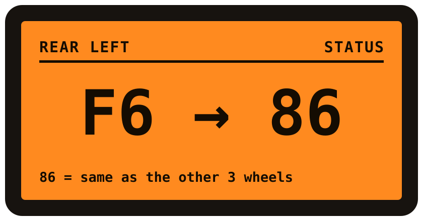
</p>

It works on one family of sensor, the Continental / VDO TG1C, fitted by
Jaguar, Land Rover, Volvo, Mazda and others. It has been proven on one car.

<!-- DRIVE-RESULT-START -->
> [!NOTE]
> **Confirmed by the car, 12 November 2026.**
> One command from a Flipper, held at the tyre valve of a Jaguar XF, changed a
> stuck sensor's status to the value the car's three working sensors report.
> On the drive that followed the dashboard showed a pressure for all four
> wheels (35, 35, 35 and 36 psi) and the car's own test status read OK for all
> four sensors. Before the command the car logged "no signal" for that wheel.
> This is one car and one sensor. It has kept working since, through driving
> and parking (the owner's report, 23 November 2026).
<!-- DRIVE-RESULT-END -->

**On this page:**
[Is this your problem?](#is-this-your-problem) ·
[What is going on](#what-is-going-on) ·
[What you need](#what-you-need) ·
[Fix a sensor in three steps](#fix-a-sensor-that-is-in-shipping-mode) ·
[Which cars](#which-cars) ·
[How far to trust it](#how-far-to-trust-it) ·
[Questions people ask](#questions-people-ask) ·
[Technical detail](#technical-detail)

Prefer pictures? The [illustrated guide](https://jh502.github.io/TPMSFlipper/)
tells the same story as one web page.

## Is this your problem?

It may be, if all of these are true:

- You had a **new or replacement TPMS sensor** fitted, or a set of new wheels
  or winter wheels with new sensors in them.
- **One wheel shows no pressure** on the dashboard, or dashes, while the
  others read normally.
- A **TPMS fault or tyre pressure warning** comes on, often some minutes into
  a drive.
- The tyre is at the right pressure when you check it with a gauge.
- A garage or a cheap TPMS tool says the sensor is **not working**, **not
  responding while driving**, **in ship mode**, **in storage mode** or **not
  activated**. Or they can read it at the wheel, but the car still cannot.
- Your car is one of the [makes that use this sensor](#which-cars).

It is probably something else if:

- The sensor is years old and has stopped. Its battery is likely flat. The
  battery is sealed in and the sensor has to be replaced.
- The car reads the sensor but shows the wrong wheel, or asks for a relearn.
  That is the car learning sensor IDs, which this app does not do.
- The sensor is a blank "universal" one that has to be programmed with a
  protocol before use. This app does not program sensors.
- Your car is not on the list. Other sensor families use other signals.

## What is going on

TPMS is the tyre pressure monitoring system. Each wheel has a small
battery-powered sensor behind the valve, inside the tyre. It sends pressure
and temperature to the car by radio, and the car shows them on the dashboard.

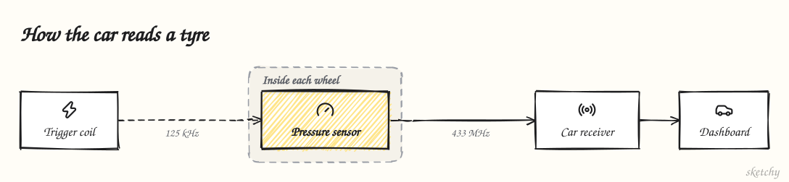

New sensors leave the factory in a deep sleep called **shipping mode** (also
called ship mode, storage mode or off mode), so they do not drain their
battery on a shelf. A sensor still in that mode ignores the turning wheel. It
is fitted and healthy, and it says nothing while you drive.

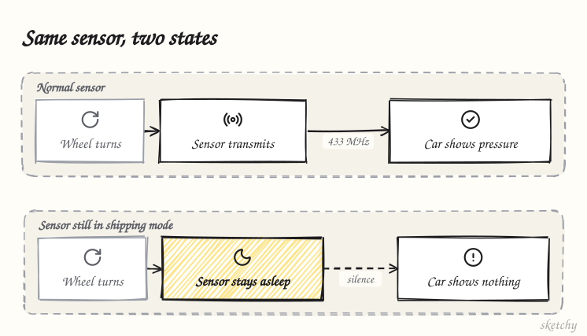

The sensor has to be told to leave shipping mode. The instruction is a radio
message on 125 kHz, sent from a few centimetres away. Workshop TPMS tools can
send it. Many cheaper trigger tools can wake a sensor and read it but cannot.
The project owner's own estimate for a tool that can do this job is around
£1000.

A Flipper Zero has both radios the job needs. The coil on its back, normally
used for access cards, sends the 125 kHz message. Its Sub-GHz radio hears the
sensor's answer.

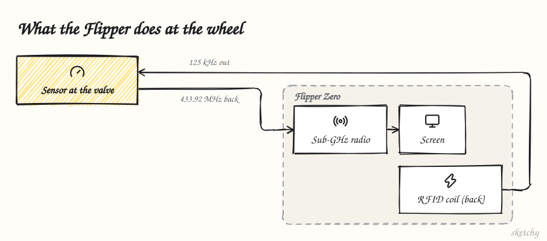

| | Workshop TPMS tool | Flipper Zero with TPMSFlipper |
|---|---|---|
| Wakes and reads a sensor | Yes | Yes |
| Takes it out of shipping mode | Yes, on models that have the function | Yes, with the same command |
| Sensor types covered | Many makes and families | One family: Continental / VDO TG1C |
| Relearn, programming, OBD | Yes | No |
| Cost | Around £1000 (the owner's estimate) | A Flipper Zero. The app is free |

## What you need

- A **Flipper Zero** with a microSD card, on official firmware 1.5.1-rc
  (target 7, API 88.2). The app is built against that firmware. On another
  version the Flipper may refuse to load it; build it yourself in that case
  (see [Build and test](#build-and-test)).
- **`tpmsflipper.fap`** from [`release/TPMSFlipper-v1.0.0/`](release/TPMSFlipper-v1.0.0/).
- A car with Continental / VDO TG1C sensors: see [Which cars](#which-cars).

### Install

1. Connect the Flipper with qFlipper or the Flipper mobile app.
2. Copy `tpmsflipper.fap` to `SD Card/apps/Sub-GHz/`.
3. On the Flipper open Apps, then Sub-GHz, then TPMSFlipper.

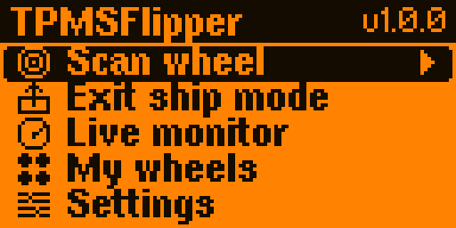

## Fix a sensor that is in shipping mode

1. Find the wheel that is missing on the dashboard.
2. Choose **Exit ship mode**. Hold the back of the Flipper flat against the
   tyre, right at the valve, and press OK.
3. **Read.** The app wakes the sensor and shows what it found. If it says
   PARK MODE and "already OK", this sensor is working and nothing is sent.
4. **Send.** If it says SHIP MODE, press OK to confirm. Keep the Flipper
   still. The app sends the command and stops as soon as the sensor
   acknowledges it.
5. **Check.** The app waits, wakes the sensor again and compares. This can
   take a minute, because a sensor that has left shipping mode only listens
   about twice a minute.
6. Read the verdict, then drive. The car decides whether the fix worked.

| Verdict on screen | What it means | What to do |
|---|---|---|
| **Sensor is awake** | The status changed to a working sensor's value. The screen shows the status before, in the answer, and after | Drive to confirm |
| **No change** | The sensor answered and its status is the same as before | Reposition at the valve and run it again |
| **No answer yet** | Nothing was heard after the command, in 84 seconds of waking | Wait a minute, then use Scan wheel. Silence proves nothing either way |
| **PARK MODE, already OK** | Step 3 found a sensor that is already working. Nothing has been sent | Nothing. Look elsewhere for the fault |

| Confirm | Sending | Done | No change |
|---|---|---|---|
| 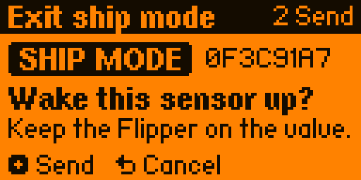 | 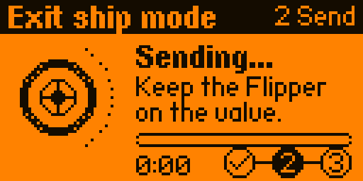 | 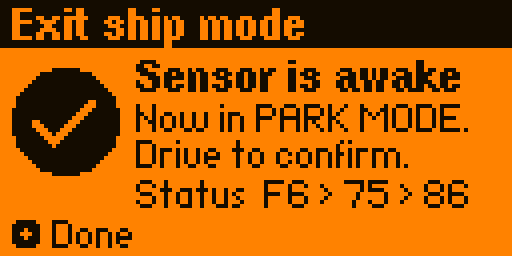 | 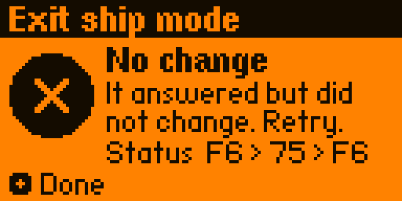 |

The verdict is about the sensor's status byte. Whether the car accepts the
sensor is decided by the car, on a drive.

## The rest of the app

### Scan wheel

Reads one sensor and changes nothing. Use it to check a sensor is alive, read
its ID, or give it a place.

1. Hold the back of the Flipper flat against the tyre, right at the valve.
2. Press OK.
3. The app sends the ordinary wake-up in 10-second bursts, for up to
   84 seconds, and stops at the first answer.

A working sensor at rest listens only every 31 to 33 seconds, so a scan can
take up to a minute. A sensor in shipping mode answered within a second in our
tests. The result screen shows pressure, temperature, the mode in words, the
sensor ID and signal strength. A detail page shows the raw status bytes.

| Scanning | Result | Detail |
|---|---|---|
| 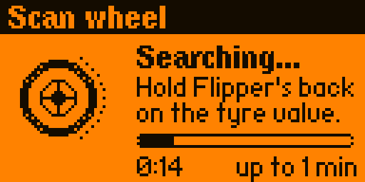 | 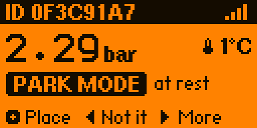 | 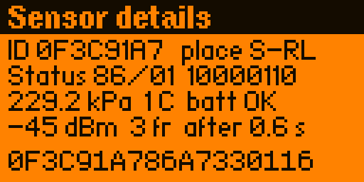 |

**If the wrong sensor answers.** The wake-up reaches every sensor near the
coil, and a scan reads the first one to answer. With wheels stacked or stored
side by side that can be a neighbour. Press Left, **Not it**. The app scans
again and ignores that sensor and every sensor that already has a place. If
none answers in 84 seconds it says "No other sensor heard". Moving the wheel
a couple of metres from the others avoids the problem.

### Live monitor

Receive only, for use in the car. It transmits nothing.

- A top view of the car with pressure and temperature at each wheel, how old
  each reading is, and the sensor's state beside the wheel name: `drive`,
  `park`, or a blinking `SHIP`.
- A list of every sensor heard. Sensors you have not placed can be given a
  place from the list.

Start it before you set off. Do not work the Flipper while driving.

Expect gaps. On the one drive logged so far, a Flipper in the cupholder heard
seven frames in 15 minutes and one wheel not at all, while the car read all
four. A wheel that says `waiting` has not been heard yet. That is the
Flipper's reception from inside the car, not a fault.

| Car view | Sensors heard |
|---|---|
| 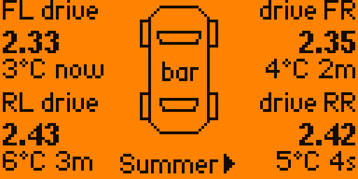 | 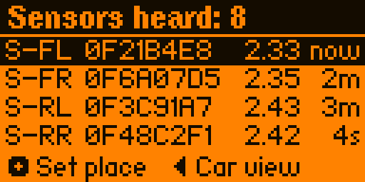 |

### My wheels

Keeps track of more than the four wheels on the car. A sensor can have one of
thirteen places:

| Place | On screen | How many |
|---|---|---|
| A wheel of the Summer set | `S-FL`, `S-FR`, `S-RL`, `S-RR` | 4 |
| A wheel of the Winter set | `W-FL` to `W-RR` | 4 |
| The spare tyre | `TYRE` | 1 |
| A loose spare sensor | `SP1` to `SP4` | 4 |

To give a sensor a place, press OK on its scan result or on its row in the
live monitor's list. My wheels shows a page per set with what each sensor
last told this Flipper and the date. A set stored in the shed keeps the
reading from the day you last scanned it.

| Where is it? | Summer set | Spares |
|---|---|---|
| 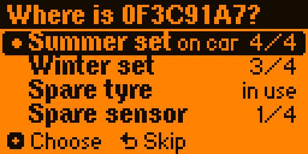 | 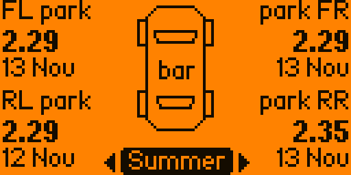 | 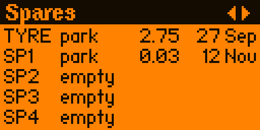 |

### Settings

| Setting | Choices | What it does |
|---|---|---|
| Pressure | bar, psi, kPa | Units everywhere |
| Temperature | °C, °F | Units everywhere |
| On the car | Summer, Winter | The set the live monitor draws |
| Ask place | if new, always, never | Whether a scan is followed by "Where is it?" |
| Radio band | 433 MHz, 315 MHz | What the app listens on: 433.92 MHz for sensors fitted in Europe, 315 MHz for North America. 315 MHz is untested |
| Which cars? | | Not a setting. The list of cars below, on the Flipper |
| Forget places | | Empties all thirteen places |
| Developer | | Not a setting. See below |

The app keeps two files on the SD card under `/ext/apps_data/tpmsflipper/`:
`wheels.cfg` (settings and places, plain text) and `log.csv` (one line per
scan or fix).

### Developer (here be dragons)

You never need this. The last row of Settings, behind a warning screen,
holds the things the app grew out of:

| Row | What it is | Sends anything? |
|---|---|---|
| Phone link | Off by default. On, the app runs a Bluetooth LE service: readings go to a phone, and a phone paired with a PIN can start scans and the monitor. No phone app is published yet | Bluetooth only |
| LF Lab | The bench tool the command was found with: wake controls, bit sweeps, test frames | 125 kHz test frames |
| Status Watch | A receive-only logger that flags a change in a sensor's status | No |
| Tool Recorder | Records the 125 kHz signal of another TPMS tool held at the Flipper | No |

The three tools are separate apps and optional. To have them, copy the three
files in the release's `dev` folder to `SD Card/apps_data/tpmsflipper/dev/`.
They do not appear in the Flipper's Apps menu. Pressing OK on one closes
TPMSFlipper and starts the tool. What each does and where it falls short is in
[docs/DEVELOPER.md](docs/DEVELOPER.md).

| The warning | The menu |
|---|---|
| 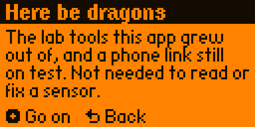 | 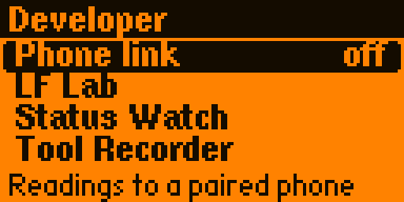 |

## Which cars

One car has been tried: a **Jaguar XF (X260)** with 433.92 MHz sensors
(sensor part number S180052076A). A workshop tool treats the sensors of
eleven more makes exactly the same way: **Land Rover, Volvo, Mazda, Abarth,
Fiat, Peugeot, Citroën, Lancia, Ford, Chrysler and Dodge**, on some models
and years. Nobody has tried this app on them.

The full list, with models and years, is
**[docs/CARS.md](docs/CARS.md)**. The app shows the same list under
Settings > Which cars?

A model name is not a promise: one model can carry different sensors in
different years and markets. The sure test is free. Run Scan wheel at the
valve. If the app reads your sensor, it is this family.

## How far to trust it

Read this before you rely on it.

Shown so far:

- A Flipper wakes and reads these sensors through the tyre, at the valve.
- Two different sensors of the family acknowledge the command.
- On the sensor the car ignored, the status changed to the working sensors'
  value and read the same in a second session.
- On the drive afterwards the car showed a pressure for that wheel and passed
  its own sensor test.
- The car has kept reading that wheel since, through driving and parking
  (the owner's report, 23 November 2026).

Not shown:

- **Any other car.** Everything above happened on one Jaguar XF.
- **Version 1.0.0 on a Flipper.** It is the first public build. It passes its
  tests on a computer with a simulated sensor, and it builds. Earlier builds
  did run: they scanned a loose sensor, the four wheels on the car, a stored
  set and a spare, and ran the exit-ship-mode sequence on a loose spare that
  was already working. The fix itself was made with the project's lab build,
  whose transmit code this app uses unchanged. The last development build,
  the same code as 1.0.0 under its working name, was installed on
  23 November 2026: its Developer menu started all three lab tools. It has
  not scanned a sensor yet.
- **315 MHz.** North American sensors of this family transmit on 315 MHz.
  The app has a setting for it. No such sensor has been near it.

**If you try it on your car, please [open an issue](https://github.com/jh502/TPMSFlipper/issues) and say
what happened, even if nothing did.** Make, model, year, the radio band and
what the scan screen showed are enough. That is how the list of cars gets
better.

## Safety and the law

- The 125 kHz signal reaches a few centimetres. It affects the sensor you
  hold the Flipper against.
- The command is meant to change a sensor's mode. Use it on your own sensors.
- The command, like the wake-up, reaches every sensor near the coil, not only
  the one the app read. Keep other wheels a couple of metres away if you do
  not want them to receive it.
- Radio rules differ between countries. Check yours.
- No warranty. A TPMS warning can also mean a flat tyre. Check pressures with
  a gauge first.

## Questions people ask

**Why is my new TPMS sensor not showing a reading?**
There are several possible reasons. One of them is that the sensor is still
in shipping mode: it is fitted and working, but it will not transmit while you
drive until it is told to leave that mode. That is the case this app fixes,
for one family of sensor.

**What is TPMS shipping mode?**
A deep sleep that sensors are put in at the factory to save the battery
during storage. Tools and forums also call it ship mode, storage mode, off
mode or sleep mode. A sensor in this mode answers a tool held at the wheel
but stays silent on the road.

**Is a sensor in shipping mode the same as one that is "not programmed"?**
No. Programming means writing a protocol into a blank universal sensor, and
relearning means teaching the car a sensor's ID. A sensor in shipping mode
may need neither. On the car this was proven on, the dashboard showed the
wheel on the first drive after the mode command.

**Can a Flipper Zero activate a TPMS sensor?**
For the Continental / VDO TG1C family, yes: its 125 kHz coil can wake the
sensor and send the command that takes it out of shipping mode, and its
Sub-GHz radio reads the answer. Other sensor families use other signals,
which this app does not send.

**Does it work on tire pressure sensors in North America?**
The same sensors are fitted there with a 315 MHz transmitter. The app can
listen on 315 MHz, but that has not been tested.

**Do I have to take the tyre off?**
No. Hold the Flipper against the outside of the tyre at the valve.

**Will it clear the TPMS warning light?**
Not directly. It changes the sensor. The car clears its own warning once it
hears the sensor on a drive.

## Technical detail

| | Flipper to sensor | Sensor to Flipper |
|---|---|---|
| Frequency | 125 kHz, on/off keyed | 433.92 MHz or 315 MHz, FSK |
| Flipper hardware | RFID coil | CC1101 Sub-GHz radio |
| Frame | 184 slots of 128 µs | 9 bytes |

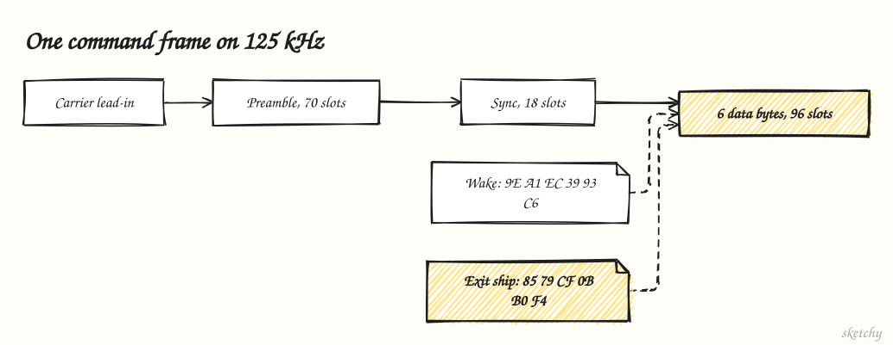

| Frame | Six data bytes |
|---|---|
| Wake | `9E A1 EC 39 93 C6` |
| Exit ship mode | `85 79 CF 0B B0 F4` |

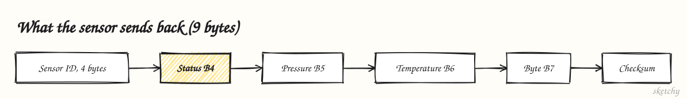

Pressure is byte 5 × 1.3725 kPa. Temperature is byte 6 − 50 °C. Byte 4 is
the status byte, and its first digit is what the app turns into a mode:

| On screen | Status byte | What it is |
|---|---|---|
| PARK MODE | `8x` | A working sensor at rest, answering the Flipper's wake |
| DRIVE | `6x` | A working sensor sending on its own while the wheel turns |
| SHIP MODE | `Fx` | A sensor still in its storage state, answering a wake. It never sends on its own |
| BUSY | `7x` | The short answer a sensor gives to the exit-ship-mode command |

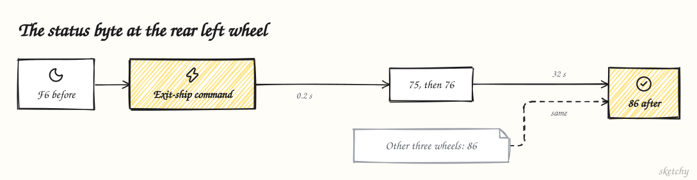

The mode words are this project's names for what was observed. They are not
the maker's. The full reference is
[docs/TG1C-STATUS-CODES.md](docs/TG1C-STATUS-CODES.md).

The command was read from the firmware update file of a workshop tool, where
it sits behind a "DISABLE SHIPPING MODE" function. The details, the evidence
and the dead ends are in [docs/FINDINGS.md](docs/FINDINGS.md). There is also
an [illustrated guide](https://jh502.github.io/TPMSFlipper/), the same story
with more pictures.

### Build and test

You need Python 3, a C compiler and
[uFBT](https://github.com/flipperdevices/flipperzero-ufbt) with the SDK for
firmware 1.5.1-rc.

```sh
sh tests/run-tests.sh            # host tests: engine, settings file, log, every screen, keys
sh tests/run-tests.sh --screens  # also redraw the screenshots in docs/img/
cd flipper/tpmsflipper && ufbt   # build dist/tpmsflipper.fap
cd flipper/dev/lf_lab && ufbt    # a lab tool; the same in status_watch and tool_recorder
```

The screen tests draw with the Flipper's own fonts, which they read from the
SDK's `firmware.elf` (under `$UFBT_HOME`, by default `~/.ufbt`). Without the
SDK that part is skipped.

Things to know about the source:

- **What the main app transmits is fixed.** It builds two frames, the wake
  and exit ship mode. The second leaves through one function, called from the
  confirm screen only. The test script fails if either stops being true.
- **The frame code is shared with the LF Lab.** `tg1c_frame.h` also holds the
  lab's test-frame builders. The main app does not call them.
- **The phone link is off until you switch it on.** `wt_link.h`,
  `wt_link_ble.c` and `wt_remote.h` are a Bluetooth link for a phone app that
  is still being tested ([docs/PHONE-LINK.md](docs/PHONE-LINK.md)). Setting
  `WT_PHONE_LINK` to 0 in `wt_build.h` builds the app without any Bluetooth
  code.
- **The lab tools have no tests here.** Their host tests replay the owner's
  recordings, which are not published. Only the main app is tested in this
  repository.
- **Comments mention lab notes.** Paths such as `analysis/...` and
  `docs/TG1C-LF-LAB.md` point into the project's lab notebook, which is not
  published.
- **Identifiers start `wt_`,** from the app's working name.

## Licence and credits

- GPL-2.0-or-later, see [LICENSE](LICENSE). The telemetry decoder is derived
  from the Abarth 124 TPMS decoder in
  [rtl_433](https://github.com/merbanan/rtl_433).
- The receive session started from
  [flipper-zero-tpms](https://github.com/VishovVladimir/flipper-zero-tpms) by
  Vishov Vladimir, MIT licence, see
  [licenses/MIT-flipper-zero-tpms.txt](licenses/MIT-flipper-zero-tpms.txt).
- The test suite draws the screens on this page with the Flipper's own fonts.
  The sensor IDs in them, and in the tests, are made up.
- Diagrams drawn with Sketchy (MIT) in the Kalam typeface (SIL Open Font
  License).
- Not affiliated with Flipper Devices, Continental, Jaguar Land Rover or any
  tool maker. Names identify what was tested.
