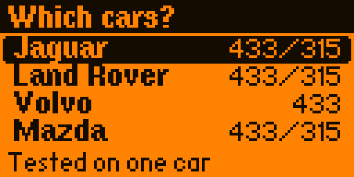
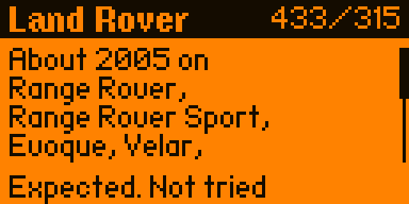

# Which cars use this sensor

<!-- Generated by flipper/tpmsflipper/cars/gen_cars.py from cars.json. Do not edit by hand. -->

TPMSFlipper reads one family of tyre sensor: Continental / VDO TG1C family.
It has been run on **one car**, a Jaguar XF (X260). The rest of this list is
cars for which a workshop tool uses the same wake signal, the same radio
set-up and the same decoder as for that Jaguar. Nobody has tried this app on
them. If you do, please say what happened.

The Flipper app shows the same list under *Settings > Which cars?*.

 

| Make | Models | Years | Sensor radio, MHz | Status |
|---|---|---|---|---|
| Jaguar | XE, XF, XJ, XK, F-Type, F-Pace, E-Pace, I-Pace, S-Type, X-Type | About 2004 on | 433 and 315 | Tested: XF (X260): scan, exit ship mode and live monitor, November 2026 |
| Land Rover | Range Rover, Range Rover Sport, Evoque, Velar, Discovery, Discovery Sport, Defender (2019 on), Freelander, LR2, LR3, LR4 | About 2005 on | 433 and 315 | Expected, not tried |
| Volvo | C30, C70, S40, S60, S80, V40, V50, V60, V70, XC60, XC70 | About 2004 on | 433 | Expected, not tried |
| Mazda | 2, 3, 5, 6, CX-3, CX-30, CX-5, CX-50, CX-60, CX-7, CX-70, CX-80, CX-9, CX-90, MX-30, MX-5, RX-8 | About 2004 on | 433 and 315 | Expected, not tried |
| Abarth | 124 Spider | 2016 on | 433 and 315 | Recordings decode: Recordings of a 124 Spider's four sensors decode; nothing sent to one |
| Fiat | 124 Spider (2016 on), Ulysse (2005 to 2010) | 2005 to 2010, 2016 on | 433 and 315 | Expected, not tried |
| Peugeot | 1007, 207, 307, 407, 508, 607, 807 | About 2004 to 2015 | 433 | Expected, not tried |
| Citroën | C4, C5, C6, C8 | About 2004 to 2013 | 433 | Expected, not tried |
| Lancia | Phedra | 2005 to 2010 | 433 | Expected, not tried |
| Ford | Galaxy, Mondeo, S-Max | About 2006 to 2014 | 433 | Expected, not tried |
| Chrysler | Pacifica, Town & Country | 2004 to 2005 | 315 | Expected, not tried |
| Dodge | Caravan, Grand Caravan | 2004 to 2005 | 315 | Expected, not tried |

- **A model name is not a promise.** One model can carry different sensors in
  different years and markets. The sure test is a scan at the wheel.
- **433 or 315.** Cars sold in Europe use 433.92 MHz. Cars sold in North
  America mostly use 315 MHz: set *Settings > Radio band* on the Flipper.
- **"Recordings decode"** means published radio recordings of that car's
  sensors read correctly with this app's decoder. Nothing was sent to one.
- **Where the list comes from.** It is condensed from the vehicle table of a
  workshop TPMS tool, not from the car makers.
