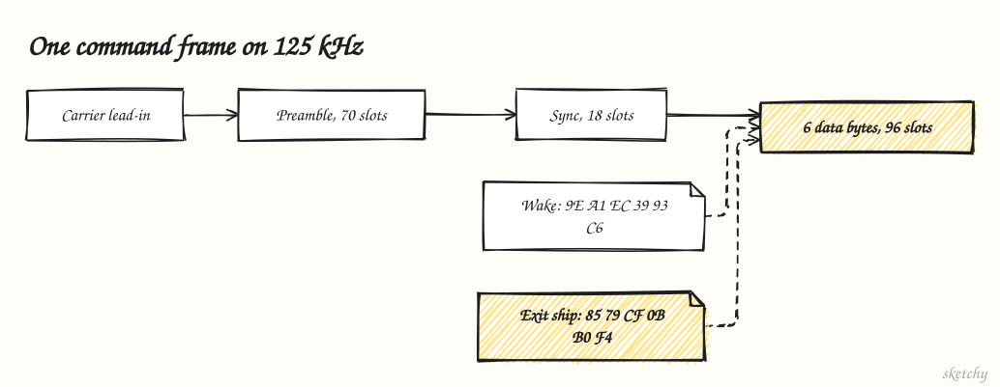
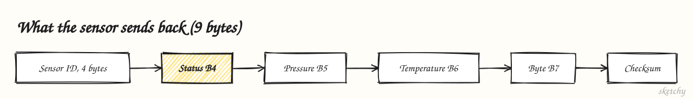
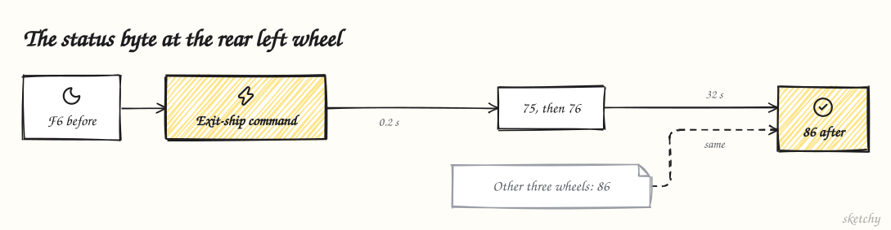

# TPMSFlipper: findings

What the project found, what the evidence is, and what is still unknown. For
readers who want the detail behind the [README](../README.md)
and the [illustrated guide](index.html).

<!-- DRIVE-RESULT-START -->
> **Confirmed by the car, 12 November 2026.**
> After the command the sensor reported the same status as the working
> sensors and took up their listening rhythm. On the drive that followed the
> dashboard showed a pressure for all four wheels and the car's own test
> status read OK for all four sensors. Before the command the car logged "no
> signal" for that wheel. One car and one sensor. It has kept working since,
> through driving and parking (the owner's report, 23 November 2026).
<!-- DRIVE-RESULT-END -->

Scope: one car (Jaguar XF, X260), one sensor family (Continental / VDO TG1C,
433.92 MHz), one evening at the wheel. Other cars and sensor families are
untested.

Names in code type such as `tg1c-park-bad-20261112` are entries in the
project's lab notes. The notes, the captures and the owner's photos are not
published.

## Result

On 12 November 2026 a Flipper Zero, held at the rear left tyre valve, sent one
burst of a six-byte LF command to a replacement sensor the car had never
shown.

- The sensor acknowledged 0.2 s into the burst, after five frames.
- Its status byte went from `F6` to `86`.
- `86` is what the car's three working sensors reported the same evening.
- It stopped answering a wake within a second and began answering at moments
  about 31 s apart, as working sensors do.
- A second session a minute later read `86` again.
- Before the drive the owner read and cleared the car's stored fault for that
  wheel, `C1A60-31`, "no signal".
- On the drive the dashboard showed 35, 35, 35 and 36 psi, and the car's test
  status read OK for all four wheel units (the owner's photos).
- A Flipper in the car, receiving only, heard that sensor transmit on its own
  five times during the drive, with its pressure and temperature rising.
  Those frames have status `66`.

Sources: `analysis/tg1c-park-bad-20261112/RESULT.md`
for the command, `analysis/tg1c-drive-20261112/RESULT.md`
for the drive.

## The two radio links

| | Flipper to sensor | Sensor to Flipper |
|---|---|---|
| Frequency | 125 kHz, on/off keyed carrier | 433.92 MHz, FSK |
| Flipper hardware | RFID coil; TIM1 with DMA, one sample per 8 µs carrier period | CC1101 Sub-GHz radio |
| Symbol timing | 128 µs half-bit, Manchester | 52 µs chip, Manchester |
| Frame | 184 slots, about 23.6 ms | 9 bytes |
| Range | Centimetres: the Flipper's back at the valve | Metres |

LF is broadcast. It is not addressed to a sensor ID; the short range is what
selects the sensor.

## The LF frame

| Part | Slots | Content |
|---|---|---|
| Lead-in | (2.048 ms) | Plain carrier before each frame |
| Preamble | 70 | 35 pairs of on, off |
| Sync | 18 | The "9T" pattern of NXP's TPMS reference code: `1 1 1 0 0 0 1 0 1 1 0 0 1 1 0 0 1 0` |
| Data | 96 | Six bytes, Manchester, a 1 sent as on then off |

A slot is 128 µs. Frames are sent with an 8 ms gap, for 10 s (289 to 294
frames in the logs), followed by 2 s of listening.

| Frame | Data bytes | As the workshop tool stores them | Seen to do |
|---|---|---|---|
| Wake | `9E A1 EC 39 93 C6` | `61 5E 13 C6 6C 39` | Sensor transmits telemetry while the frame is on air |
| Exit ship mode | `85 79 CF 0B B0 F4` | `7A 86 30 F4 4F 0B` | Short acknowledgement; status changed afterwards on the stuck sensor |

The two columns are the same bits with opposite polarity. In both frames the
last four bytes are one byte written four ways. The first two bytes differ
(`9E A1` against `85 79`).

## The telemetry frame

| Bytes | Field | Reading |
|---|---|---|
| 0-3 | Sensor ID | Unique to the sensor |
| 4 | Status (B4) | Carries the mode; see below |
| 5 | Pressure | Value × 1.3725 kPa, gauge. The car's own readings are whole multiples of 1.3725. A loose sensor on the bench reads 3 to 4 kPa |
| 6 | Temperature | Value − 50 °C. Agreed with the car to 1 °C |
| 7 | B7 | `01` or `02` in a wake reply; different in every frame while driving. Not decoded |
| 8 | Checksum | XOR of bytes 0 to 7 |

The decoder is derived from the Abarth 124 decoder in rtl_433
(`tpms_abarth124.c`), which reads the same telegram.

## The status byte

The reference for these codes is
[`docs/TG1C-STATUS-CODES.md`](TG1C-STATUS-CODES.md). In short, the first
digit says what kind of frame it is and what state the sensor is in.

| Source | B4 | Bit 7 | Bits 6-4 | Low digit | App shows |
|---|---|---|---|---|---|
| Stuck sensor before the command, answering a wake | `F6` | 1 | 111 | 6 | SHIP MODE |
| Stuck sensor answering the command | `75`, `76` | 0 | 111 | 5, 6 | BUSY |
| Stuck sensor after the command, answering a wake | `86` | 1 | 000 | 6 | PARK MODE |
| The three working sensors, same evening | `86` | 1 | 000 | 6 | PARK MODE |
| Bench spare, answering a wake, 23 °C | `87` | 1 | 000 | 7 | PARK MODE |
| Bench spare answering the command | `77` | 0 | 111 | 7 | BUSY |
| Three sensors while driving, sent on their own | `66` | 0 | 110 | 6 | DRIVE |
| Four Abarth sensors being inflated (third-party recordings) | `B7` | 1 | 011 | 7 | STATUS B7 |

- **Bits 6, 5 and 4 cleared together** on the stuck sensor. This run cannot
  say which of the three is the shipping flag.
- **Bit 7** is set in every direct reply to a wake and clear in every frame a
  sensor sent on its own timing. An observation, not a decoded meaning.
- **The low digit follows temperature.** It was 7 at 19 to 23 °C and 6 at 1 to
  12 °C on every sensor. The stuck sensor went from `F7` to `F6` during its
  first reply in the cold, with only the stock wake sent.
- **The app's mode words use the first digit:** `8` PARK MODE, `6` DRIVE, `F`
  SHIP MODE, `7` BUSY; anything else is shown as the byte. Version 0.1.0 used
  the top two bits, which would have called a driving frame BUSY. The names
  are this project's. No mode names were found in the workshop tool's
  firmware.
- **No battery reading for a driving frame.** The two battery rules read from
  the workshop tool apply to wake replies; on a `66` frame both would say low.

## Timing

- **A working sensor listens for LF only now and then.** On the bench the
  spare answered at moments 31 to 33 s apart (31.0 and 31.1 s in two sessions,
  32.6 and 32.7 s in two later ones; why it moved is not known). A burst
  shorter than the gap can miss the moment, which is why 5 s bursts were
  unreliable and repeated 10 s bursts are not.
- **The sensor in shipping mode answered within a second.** First reply 0.26
  to 0.92 s into the burst in five sessions out of five once the Flipper was
  positioned, and 0.68 s in the session that sent the command.
- **A wake reply stops when the LF stops.** Two or three more frames within
  0.3 s, then nothing.
- **The acknowledgement of the command is different.** 10 to 14 frames in five
  groups about 1.4 s apart, carrying on for about 6 s with the LF off.
- **After the command the stuck sensor kept the working rhythm.** Its next
  reply came 32.1 s after the first frame of its acknowledgement; the one
  after that, 31.1 s later.

## How the command was found

Read from code, not captured on air.

- The source is the firmware update file of a workshop TPMS tool.
  It was read statically with a hand-written
  disassembler. The file stays outside the repository.
- The tool holds the wake frame (`61 5E 13 C6 6C 39` in its polarity) and
  sends it for 29 sensor types, among them both types used only by Jaguar and
  Land Rover.
- One of its screen messages is "DISABLE SHIPPING MODE". The menu item is offered on
  128 vehicle entries of 11 sensor types. Its handler sets a flag and starts
  LF.
- With the flag set, the LF routine for the Hyundai H-1 type builds
  `7A 86 30 F4 4F 0B` in place of the wake frame. Sync and framing are
  unchanged. Inverted to this project's polarity that is `85 79 CF 0B B0 F4`.
- For the two Jaguar and Land Rover types no path was found that swaps the
  frame. That fits the one public account we have: an owner of the same
  sensor family reported using the function under the Hyundai H-1 entry,
  after which a second tool showed two of their sensors as "Park" where it
  had shown "Ship" (a post on an owners' forum).
- The same six bytes are the tool's normal trigger for a Nissan sensor type.

Notes with addresses: `analysis/research-options-20261112/NOTES.md`,
sections 7 to 9.

## Evidence, in order

### 1. On the bench: a normal sensor recognises the frame

Loose spare, already in normal mode, against the back of the Flipper.

- It acknowledged the command with status `77` in four sessions out of four,
  each time at its next listening moment, on the third burst.
- A later wake was answered with `87`, as before. No visible harm.
- No altered wake frame had ever drawn a reply from it (see "What did not
  work").

Sources: `tg1c-park-20261112`,
`tg1c-park-wheel-20261112`,
`tg1c-park-spare-v036-20261112`.

### 2. At the wheel: the Flipper reaches a sensor inside a tyre

- After one session with no answer (position), five sessions in a row were
  answered, at −44 to −43 dBm.
- The stuck sensor reported `F7` twice and then `F6`. The app version of the
  day treated `F6` as a new status and stopped before sending the command.

Source: `tg1c-park-wheel-20261112`.

### 3. At the wheel: the command

| Time in session | Flipper, 125 kHz | Sensor, 433.92 MHz |
|---|---|---|
| 0 to 10 s | Wake burst | `F6`, 52 frames, first at 0.68 s |
| 12.0 to 12.2 s | Command burst, cut after 5 frames | First acknowledgement frame at 12.2 s |
| 12.2 to 18.1 s | Off | `75` (3 frames) then `76` (9 frames), five groups 1.39 s apart |
| 18.1 to 23.1 s | Off | Silent; the app waits for 5 s of quiet |
| 23.1 to 33.1 s | Wake burst | No answer |
| 35.1 to 44.3 s | Wake burst, cut at the answer | `86` at 44.3 s |

Then, in separate sessions the same evening:

| Wheel | Status | Pressure | Temperature |
|---|---|---|---|
| Rear left (the stuck sensor), a minute later | `86` | 230 kPa | 1 °C |
| Rear right | `86` | 236 kPa | 2 °C |
| Front right | `86` | 230 kPa | 2 °C |
| Front left | `86` | 230 kPa | 2 °C |

Source: `tg1c-park-bad-20261112`.

Three things changed at once, and each now matches a working sensor: the
status byte, the answer to a wake, and the listening rhythm. The car then
showed the wheel on the next drive.

## What did not work

The command was found by reading, after weeks of trying to find it by
experiment. The records are in the lab notes.

- **Single-bit sweep.** All 48 one-bit variants of the wake frame were sent to
  the spare, 17 of them twice. None got a reply, and each was followed by an
  answered unaltered frame. The sensor checks every bit.
  (`tg1c-sweep-rerun-20261112`)
- **Dilution.** Bursts of mostly altered frames with the real wake every 2nd
  to 32nd frame. With one filler the spare answered 9 of 9 at 1 in 2, 4 and 8
  and 0 of 6 at 1 in 16 and 32; with another it answered all 15. Reading: it
  examines at least five frames each time it listens. No new command.
  (`tg1c-dilution-fill40-20261112`)
- **NXP bootloader CONNECT.** NXP publishes a bootloader for this class of
  sensor chip with an LF connect message. 57 bursts in three forms over seven
  sessions drew no sync and no valid reply. Inconclusive: it does not show
  the sensor has no bootloader.
  (`tg1c-cycle-check-20261111`)
- **Passive listening.** The spare sent nothing unprompted in 45 minutes on
  the bench.
  (`tg1c-passive-listen-20261111`)
- **Chasing status `77`.** Seen twice by chance, on 17 October and
  11 November, and not reproduced by repeating the timing that came with it.
  The spare reports the same status when it acknowledges the command. Whether
  the earlier sightings had that cause is not known.
  (`status-77-20261111`)

## Not known

- What the sensor's modes are called, and which bit of B4 carries the mode.
- What `75`, `76` and `77` mean beyond "acknowledging".
- Whether the change lasts through months and long parking. The owner reports
  that it has kept working from 12 to 23 November 2026, through driving and
  parking. Nothing was logged in that time, and the fault code has not been
  read again.
- How often a sensor transmits while driving. From inside the car the Flipper
  heard seven frames in 15 minutes and one wheel not at all.
- Whether the frame works on TG1C sensors fitted to other makes. The tool
  offers its function for 11 sensor types on cars of more than ten makes, which
  suggests it is not specific to one car. Nothing here tests that.
- What byte 7 carries while driving.

## The app and the lab build

The runs above used the project's lab build, versions 0.3.4 to 0.3.6. Its
source is here as the LF Lab, behind the Developer menu
([DEVELOPER.md](DEVELOPER.md)). TPMSFlipper uses the same LF engine, receive
session and frame builders, so it sends the same frames with the same timing.
Version 1.0.0, the first public build, has passed its tests on a computer
with a simulated sensor and has not yet run on a Flipper. Earlier builds
have: 0.1.1 scanned the loose spare three times and ran its exit-ship-mode
sequence on it once, each ending as the lab build's did, and 0.2.0 scanned
the four wheels on the car, a stored set and a spare. The app has not been
used on a sensor in shipping mode.

Those scans showed that the LF reaches more than one sensor when wheels are
stored together: seven scans at a stored set heard only two sensors, each
answering at its own listening moments whichever wheel the Flipper was held
to. A scan reads the first sensor to answer, so 0.2.1 adds a rescan that
ignores the sensors already known.

## Sources and credits

- rtl_433 TG1C decoder: <https://github.com/merbanan/rtl_433/blob/master/src/devices/tpms_abarth124.c> (GPL-2.0-or-later).
- Bartec TECH500 user guide, Appendix C, on "Set Sensor to Park Mode": <https://www.libble.de/bartec-tech-500/p/978344/?page=0025>
- Diagrams drawn with Sketchy (MIT) in the Kalam typeface (SIL Open Font License).
